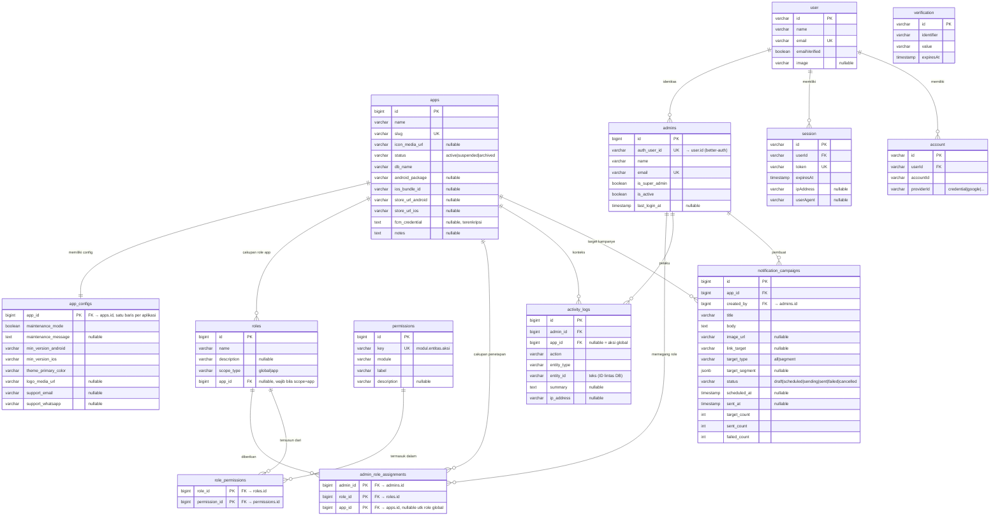
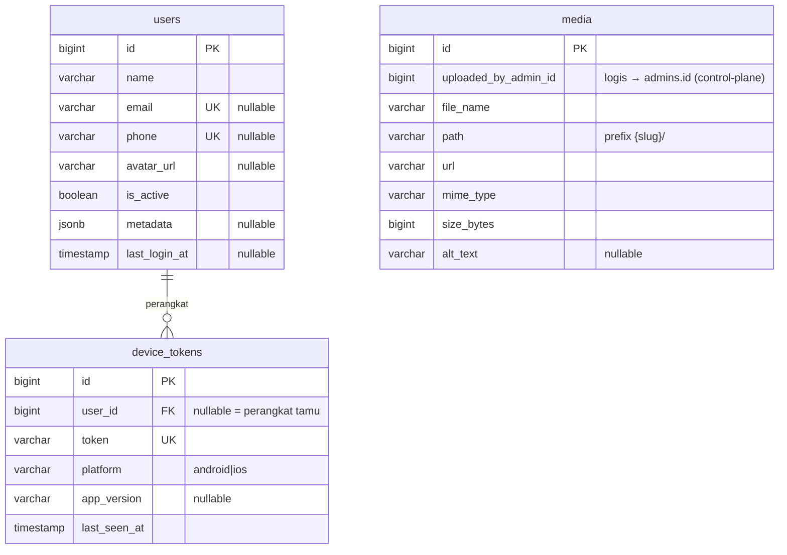

# 17 — ERD (Entity Relationship Diagram)

Diagram database platform: control-plane + template App DB. Satu sumber kebenaran skema tetap [06-database-design.md](06-database-design.md) — dokumen ini adalah visualisasinya.

> Cara melihat: GitHub me-render blok `mermaid` otomatis. Di VS Code, pakai extension Mermaid preview. Atau tempel ke [mermaid.live](https://mermaid.live).

Konvensi diagram (dari doc 06, tidak digambar agar ringkas): semua tabel memakai PK `id bigint`, kolom `created_at`/`updated_at`, dan soft delete via `deleted_at` — kecuali `activity_logs` (append-only) dan tabel better-auth (dikelola library).

## 1. Control-Plane DB (`platform`)

Catatan:

- `admins.auth_user_id → user.id` adalah tautan logis identitas-profil (satu profil per identitas).
- Kolom better-auth mengikuti versi library yang dipakai; yang digambar adalah kolom inti.
- Kolom tambahan dari doc 13 (`apps.status` = `provisioning`/`failed`, `failure_reason`, `last_provisioning_at`) **belum** masuk diagram — menunggu rekonsiliasi saga (temuan audit).

## 2. Template App DB (`app_{slug}`)

Dibuat identik untuk setiap aplikasi saat provisioning, lalu ditambah tabel domain modulnya di Fase 2.

Catatan:

- `media.uploaded_by_admin_id` adalah referensi **logis** ke `admins.id` di control-plane — bukan foreign key (tidak ada FK lintas database, doc 06).
- Tabel domain modul (soal, produk, mosi, ...) didefinisikan di dokumen modul saat Fase 2; semuanya FK ke `users`/`media` skema ini bila perlu.

## 3. Tautan Logis Lintas Database (tanpa FK)

| Dari | Ke | Keterangan |
|---|---|---|
| `admins.id` (platform) | `media.uploaded_by_admin_id` (app) | Pengunggah file |
| `admins.id` (platform) | konteks App DB mana pun | Aktor yang tercatat di `activity_logs` |
| `apps.db_name` (platform) | database `app_{slug}` | Dipakai connection factory (doc 11), bukan relasi SQL |
| `activity_logs.entity_id` (platform) | baris di App DB | ID disimpan sebagai teks + `entity_type` |

## 4. Referensi

- [06-database-design.md](06-database-design.md) — definisi kolom, indeks, operasional backup
- [11-connection-pooling.md](11-connection-pooling.md) — cara backend memilih database per request
- [12-migration-strategy.md](12-migration-strategy.md) — `schema_migrations` per database (tabel operasional, tidak digambar)
- [16-operasional-teknis.md](16-operasional-teknis.md) — kebijakan soft/hard delete per tabel
